<!-- Hero -->

  

  

  
  
  

<h2 align="center">✨ About me</h2>

- 🍎 &nbsp;I make **small, useful macOS utilities** that live in your menu bar
- 🔌 &nbsp;I write firmware for **ESP32, NodeMCU** and every tiny display I can find
- 📡 &nbsp;I flash **OpenWrt** onto routers, cameras and anything else with a port
- 📻 &nbsp;I'm into **ham radio** and run AllStarLink nodes
- 🇧🇩 &nbsp;I build **Bangla-first apps** for everyday life in Bangladesh
- ⚡ &nbsp;Motto: *if it has a USB port, I can probably make it do something new*

<h2 align="center">🚀 Featured projects</h2>

  
  
  
  
  
  

<b>🔧 &nbsp;More hardware tinkering</b>

 

- [**ax206-display-linux**](https://github.com/ffrafat/ax206-display-linux): drive cheap AX206 USB picture-frame screens from Linux
- [**t-dongle-lcd-esp32-s3**](https://github.com/ffrafat/t-dongle-lcd-esp32-s3): firmware experiments for the LilyGO T-Dongle S3
- [**allstarlink-status-oled**](https://github.com/ffrafat/allstarlink-status-oled): AllStarLink node status on a tiny OLED
- [**Minimal Resume Portfolio**](https://github.com/ffrafat/Minimal-Resume-Portfolio-Site-for-Developers-Researchers): a clean portfolio template for devs and researchers

<h2 align="center">🛠️ Tech I play with</h2>

  
    
  
    
  

<h2 align="center">📊 GitHub stats</h2>

  
  

  

  <picture>
    <source media="(prefers-color-scheme: dark)" srcset="https://raw.githubusercontent.com/ffrafat/ffrafat/output/snake-dark.svg" />
    <source media="(prefers-color-scheme: light)" srcset="https://raw.githubusercontent.com/ffrafat/ffrafat/output/snake-light.svg" />
    
  </picture>

<!-- Footer -->

  

  

